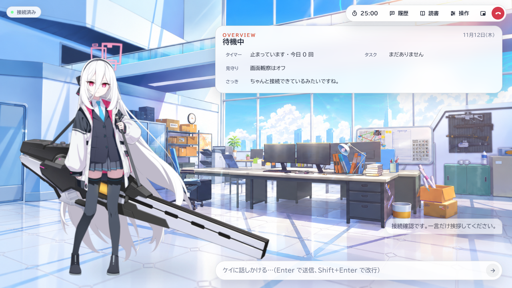
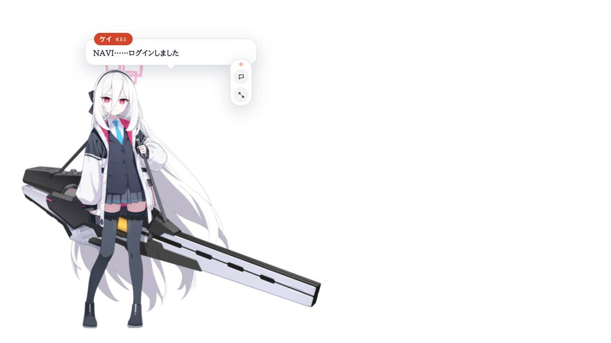
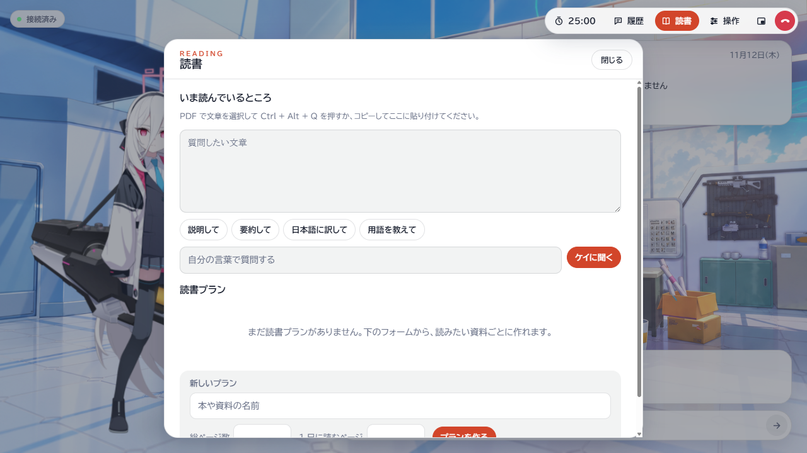
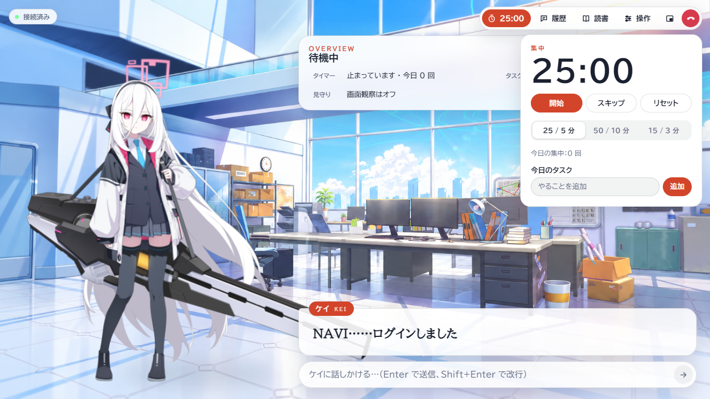

# Kei Desktop

Windows 用の Live2D デスクトップアシスタント。ケイと日本語で話し、資料を読み、作業を依頼できます。

[Windows x64 版のダウンロード](https://github.com/lain1145141919810/Kei-Desktop/releases/tag/v0.3.1) · [日本語設定ガイド](docs/STANDALONE.ja.md)

## はじめに

ZIP を展開し、Kei Desktop.exe を起動します。初回の「キャラクター設定」で名前、人格、立ち絵、起動音を設定するか、配布されたキャラクターパックを読み込めます。「操作」から管理ウィンドウを開き、会話用モデルを設定してください。Live2D は同梱されています。音声認識、読み上げ、AstrBot、DSH は必要に応じて追加できます。

| 機能 | 使い方 |
|---|---|
| 音声入力 | F8 で録音を開始・終了し、日本語の発話を会話に送ります。 |
| 長期記憶 | 好みや覚えてほしい事柄を登録すると、再起動後も関連する会話で使えます。 |
| PDF 読書 | 選択した文章を Ctrl+Alt+Q で取り込み、抜粋への質問や読書計画の作成ができます。 |
| 画面観察 | Ctrl+Alt+S で切り替え、表示中の画面について画像対応モデルに相談できます。 |
| デスクトップ小窓 | ダブルクリック、Esc、Ctrl+Alt+K で元の表示に戻れます。 |
| 集中タイマー | 作業と休憩の時間をデスクトップで管理できます。 |

[音声モデル、素材、API の設定](docs/STANDALONE.ja.md) · [従来版の移行手順（中国語）](docs/MIGRATION.zh.md) · [中国語のプロジェクト紹介](README.zh.md)

開発時は KeiDesktop フォルダーで npm ci、npm start の順に実行します。Windows 配布用 ZIP は Build-Portable.ps1 で生成できます。自作コードのライセンスと素材の出典は [LICENSE](LICENSE) および [第三者素材の表記](THIRD_PARTY_NOTICES.md) を参照してください。
