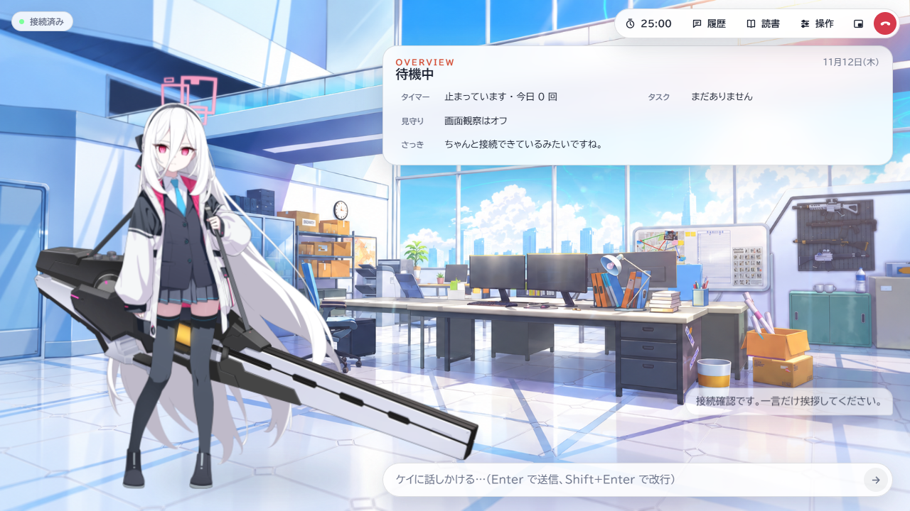
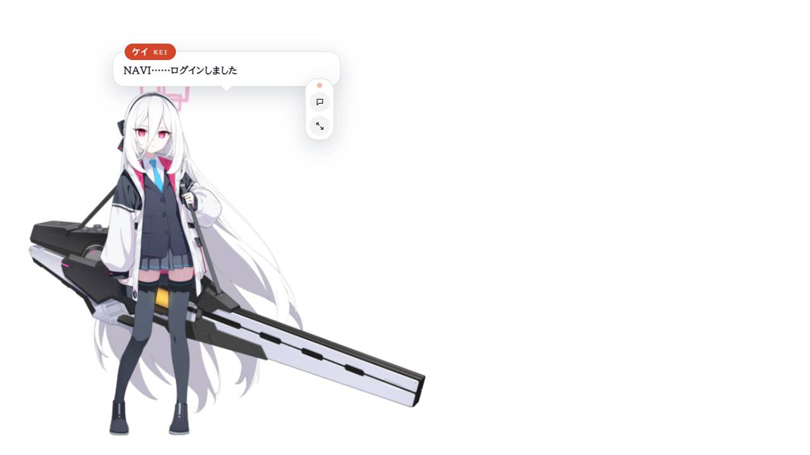
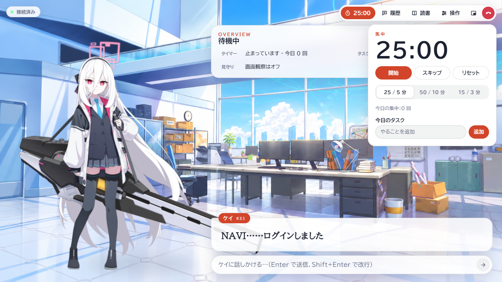
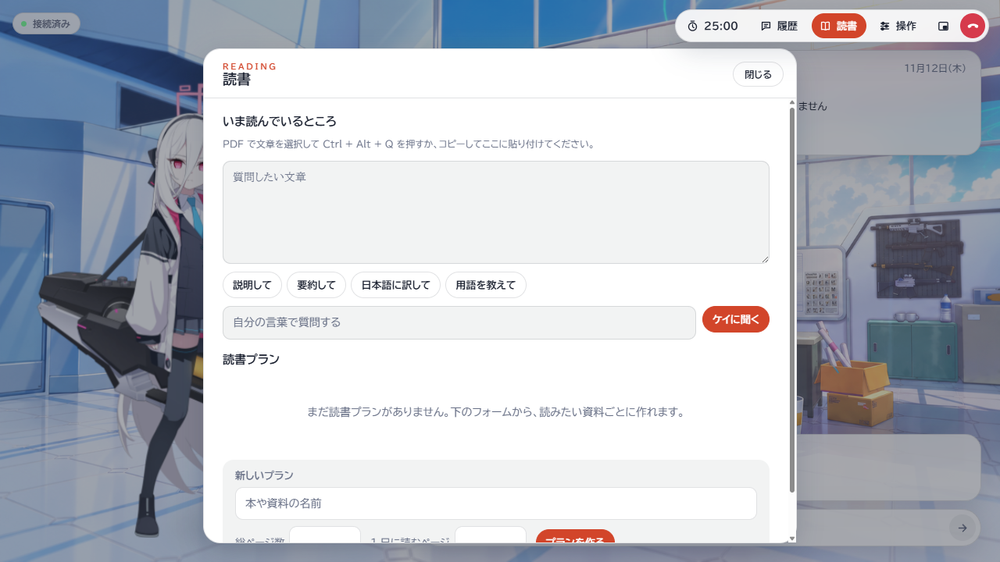

# Kei Desktop

**与你交谈，陪你阅读，也能把工作交给她。**

Windows 桌面上的 Live2D AI 助手

[功能](#功能) · [实机展示](#实机展示) · [部署与迁移](docs/MIGRATION.zh.md) · [模型配置](KeiRuntime/data/DSH-MODELS.zh.md)

## Windows 独立版

[下载 Windows x64 独立版](https://github.com/lain1145141919810/Kei-Desktop/releases/tag/v0.3.2) · [接口、语音权重与素材配置](docs/STANDALONE.zh.md)

解压后运行 Kei Desktop.exe。可直接连接模型 API，按需接入 AstrBot、DSH 和 GPT-SoVITS。独立版沿用原桌面，支持 Live2D、语音输入、本地长期记忆、PDF 选段问答和屏幕观察。

## 功能

| 日常陪伴 | 工作与学习 |
|---|---|
| **语音与文字对话** — 输入问题或直接开口，字幕、口型与表情跟随语音播放 | **任务执行** — 把工作交给 DSH 或 Codex，查看进展和执行结果 |
| **桌面小窗** — 让凯伊留在桌面，用气泡交流，随时回到完整窗口 | **子 agent 分工** — 自动委派、先询问或手动指定执行与复核模型 |
| **对话续接** — 查看历史、选择旧对话继续，长对话通过摘要开启下一段 | **文件上下文** — 拖入文件，让执行器带着资料完成任务 |
| **屏幕陪伴** — 开启观察后，让凯伊了解你眼前的工作 | **PDF 阅读** — 围绕选中文字提问，记录阅读计划与进度 |
| **存储管理** — 按日期展开记录，清理上下文，释放空闲执行器 | **专注计时** — 在对话旁使用番茄钟，安排工作与休息 |

## 实机展示

### 留在桌面的凯伊

小窗保留角色、对话气泡和输入入口。双击角色、按 Esc 或 Ctrl + Alt + K，可以回到完整窗口。

### 专注一会儿

打开计时器，在聊天与工作之间安排一段专注时间。

### 一起读一份 PDF

在阅读器中选中文字，用 Ctrl + Alt + Q 交给凯伊解释、总结或翻译，也可以制定阅读计划。

## 开始使用

准备 Windows、Python 3.11、Node.js 24 和 Git，克隆项目。

    git clone https://github.com/lain1145141919810/Kei-Desktop.git
    cd Kei-Desktop

按[部署与迁移指南](docs/MIGRATION.zh.md)安装后台、语音依赖和角色运行环境，然后启动。

    cd D:/KeiDesktop
    ./Start-Kei.ps1

DSH 模型目录支持为不同工作分配不同模型。[查看配置方法](KeiRuntime/data/DSH-MODELS.zh.md)

## 项目结构

| 目录 | 用途 |
|---|---|
| KeiDesktop/ | Electron 窗口、Live2D、界面与测试 |
| KeiRuntime/ | 对话、语音、任务执行与会话存储 |
| AstrBot-plugins/astrbot_plugin_kei/ | Kei 自身的后台桥接 |
| GPT-SoVITS-overlay/ | 语音服务适配 |

## 开源与致谢

自有代码采用 [MIT License](LICENSE)。素材与第三方组件的作者、来源和许可见[借物表](THIRD_PARTY_NOTICES.md)。
